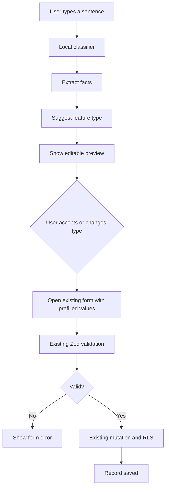

# Testing the unified capture flow

This guide explains exactly what happens when a person uses Tandem’s center **+** button and how the current tests verify it.

## The runtime flow



Example:

```text
Input:     Spent $24.50 on lunch
Type:      expense
Title:     lunch
Amount:    24.50
Next step: /expense/new with title and amount prefilled
Save:      still handled by ExpenseForm
```

The classifier never inserts a row into Supabase. The existing feature form remains responsible for the final record.

## What the automated benchmark does

The benchmark is a list of known examples with expected results:

```ts
{
  input: 'Spent $24.50 on lunch',
  expected: {
    kind: 'expense',
    title: 'lunch',
    amount: '24.50'
  }
}
```

For each example, the test:

1. Sends the sentence to `classifyCapture`.
2. Compares the predicted type with the expected type.
3. Compares the extracted title when one is specified.
4. Compares the amount when one is specified.
5. Compares the ISO date/time when one is specified.
6. Records the exact field if it fails.

The evaluator is in [lib/capture/evaluate.ts](../lib/capture/evaluate.ts). The examples and assertions are in [tests/capture-evaluation.test.mts](../tests/capture-evaluation.test.mts).

## What the metrics mean

Suppose a benchmark has 10 examples:

```text
8 predicted types are correct       → intent accuracy = 80%
9 titles are correct out of 9       → title accuracy = 100%
4 amounts are correct out of 4      → amount accuracy = 100%
3 dates are correct out of 3        → schedule accuracy = 100%
1 wrong answer was marked high      → high-confidence error rate = 10%
```

The high-confidence error rate matters more than a normal error. A medium-confidence task suggestion invites review; a high-confidence wrong expense suggestion is more dangerous.

## Running the tests

From the repository root:

```bash
npm test
```

This runs every `.test.mts` file, including the capture benchmark.

For the complete project check:

```bash
npm run check
```

That runs TypeScript, lint, and all tests.

To test only the capture files while iterating:

```bash
node --experimental-strip-types --test tests/capture*.test.mts
```

## How to add a new test case

If a sentence is misclassified, add it to the benchmark before changing code:

```ts
{
  input: 'Put oat milk on our list',
  expected: {
    kind: 'grocery',
    title: 'Put oat milk on our list'
  }
}
```

Run the test and observe the failure. Then update the classifier, rerun the test, and confirm that the older examples still pass. This prevents fixing one phrase by breaking another.

For ambiguous phrases, do not force an arbitrary expected type. Put them in a separate ambiguity group when clarification behavior exists. Examples include:

- `Call Mom tomorrow`
- `Dinner was $60`
- `Buy a birthday card`
- `Milk, eggs and bread`

Those should eventually test whether Tandem asks a useful question or presents reasonable alternatives.

## Manual browser test

1. Open Tandem and press the center **+** button.
2. Type `Spent $24 on lunch`.
3. Confirm the preview says `Expense`, `lunch`, and `$24.00`.
4. Press `Review expense`.
5. Confirm the expense form contains `lunch` and `24.00`.
6. Change Personal/Ours, payer, or split as needed.
7. Save through the normal form.
8. Confirm the saved expense appears in Money.

Repeat with:

- `Dinner Friday at 7 PM` → event form
- `Remind me to call Mom tomorrow at 3 PM` → reminder form
- `Replace the air filter` → task form
- `Milk for the grocery list` → list selection, then item form

Also test Back, an empty input, an invalid amount, no connected partner, no grocery list, and a conflicting calendar event.

## What is measured today versus later

Today’s tests measure classifier quality against a fixed, local benchmark. They do not observe real users.

Later, a privacy-safe analytics layer can measure the real flow using a temporary capture ID and no raw sentence:

```text
capture_started
capture_interpreted
capture_type_changed
capture_review_opened
capture_saved
capture_abandoned
capture_failed
```

That would answer whether the feature is useful in practice: how often people correct it, how long saving takes, and where they abandon the flow. It should be added only after choosing an analytics destination and documenting consent and retention rules.
